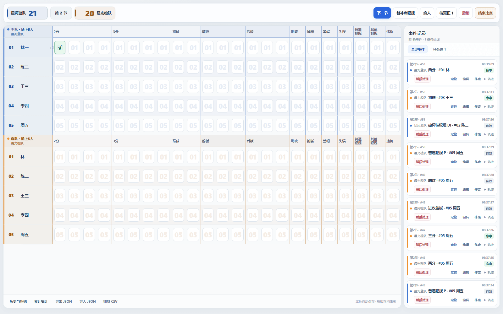
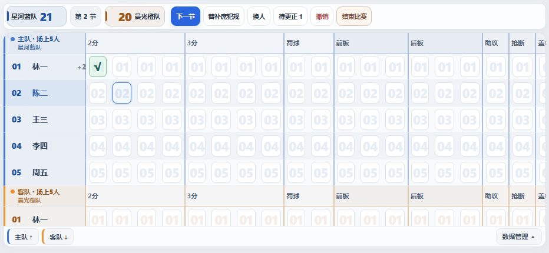
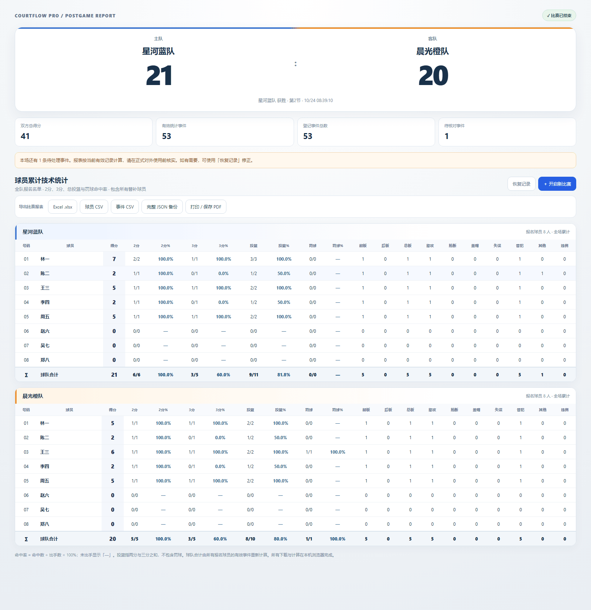
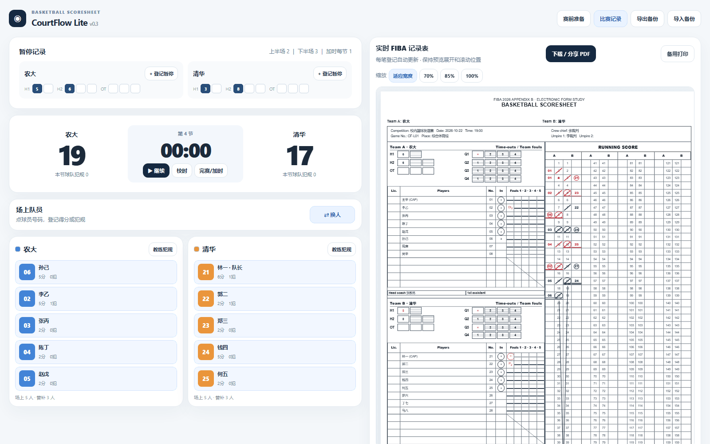
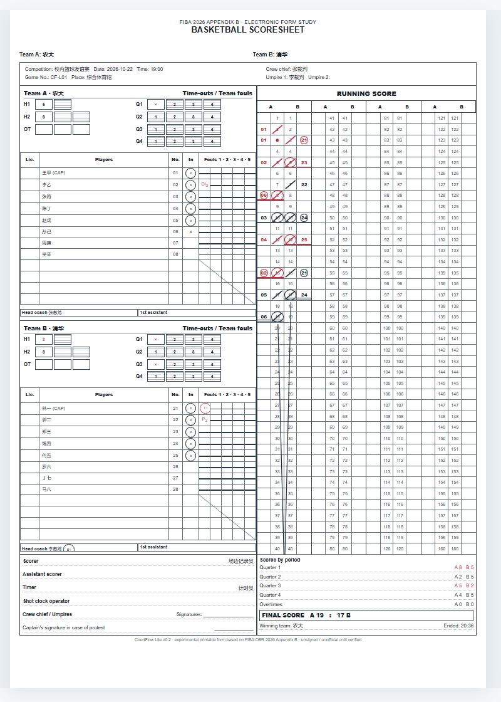

# CourtFlow

### Basketball Match Recording & Statistics

CourtFlow 是一套面向篮球比赛现场的轻量化记录工具，包含实时技术统计 **Pro** 和比赛记录表 **Lite** 两个独立系统。

无需搭建服务器，通过浏览器直接运行，支持电脑、平板及手机。比赛数据默认保存在本地浏览器，支持导出及备份，**不具备云端自动同步功能**。

## 两套独立系统

| CourtFlow Pro V4.2 | CourtFlow Lite v0.3 |
| --- | --- |
| 表格式实时技术统计，记录双方场上球员 | 赛前球队、球员与比赛资料登记 |
| 投篮、篮板、助攻、抢断、盖帽、失误等统计 | 实时计分、犯规、暂停与换人 |
| 2026 犯规类别记录、完整事件历史与纠错 | FIBA 2026 式样比赛记录表及实时预览 |
| 赛后球员累计、球队合计与命中率 | 实验性 A3 PDF 导出及备用打印 |
| Excel、CSV、JSON 及打印报表 | 独立 JSON 备份与恢复 |
| **[在线使用 Pro](https://yyysheng.github.io/basketballrecord/pro/)** · [源码](pro/index.html) · [使用指南](docs/PRO_GUIDE.md) | **[在线使用 Lite](https://yyysheng.github.io/basketballrecord/lite/)** · [源码](lite/index.html) · [使用指南](docs/LITE_GUIDE.md) |

Lite 围绕比赛记录表工作，Pro 围绕完整技术统计工作，两者是独立应用，分别运行、存储和导出。

## 真实界面

截图来自本仓库对应页面的独立浏览器运行环境，全部使用虚构球队与球员数据。手机图展示横屏视口，表格可滚动查看其他行和统计项目。

### Pro · 桌面现场统计



### Pro · 手机横屏



### Pro · 赛后累计统计



### Lite · 比赛记录



### Lite · FIBA 记录表预览



## 功能对比

| 功能 | Pro V4.2 | Lite v0.3 |
| --- | --- | --- |
| 主要用途 | 全面篮球技术统计 | 比赛记录表登记 |
| 得分、犯规与换人 | 支持 | 支持 |
| 篮板、助攻、抢断、盖帽等 | 支持独立登记 | 不提供完整技术统计 |
| 比赛计时 | 不显示计时器 | 手动控制倒计时 |
| 暂停及 FIBA 逐分记录表 | 不以记录表为主 | 支持 |
| 事件历史与纠错 | 支持，含待处理标记 | 支持 |
| 赛后球员累计与 XLSX | 支持 | 以记录表及 PDF 为主 |
| JSON 备份 / 恢复 | 独立格式 | 独立格式 |
| PDF | 浏览器打印 / 保存 PDF | 直接生成实验性 A3 PDF，含备用打印 |
| 云端自动同步 | 无 | 无 |

记录类别由现场裁判报告，输出应人工核实，不能代替裁判签署的正式记录。Lite 单页容量等限制见 [Lite 指南](docs/LITE_GUIDE.md)。

## 快速使用

1. 打开 [Pro](https://yyysheng.github.io/basketballrecord/pro/) 或 [Lite](https://yyysheng.github.io/basketballrecord/lite/)，填写球队、球员及首发信息。
2. Pro 建议横屏使用；根据现场实际情况登记，随时通过历史记录纠错。
3. 两套系统分别保存比赛。重要比赛请定期导出 **JSON 备份**，赛后再保存报表。

数据仅存当前浏览器和网站来源，清理缓存时若同时清除网站数据会丢失存档；不同设备、浏览器和本地文件之间不自动同步。两套 JSON 格式不能互相导入。

## 项目结构与技术

主要使用 **HTML、CSS、JavaScript**，通过 **GitHub Pages** 提供静态网站服务，无后端及云端比赛数据库。

```text
index.html                 根入口，自动跳转 Pro
pro/index.html             Pro V4.2 单文件应用
pro/legacy-v0.3.html        历史球权版备份
lite/index.html            Lite v0.3 单文件应用
previews/                  真实界面截图及历史预览
README.md                  项目展示与导航
SPEC.md                    当前技术规格索引
VERSION.txt                当前版本声明
CHANGELOG.md               实际提交更新记录
docs/PRO_GUIDE.md          Pro 详细使用说明
docs/LITE_GUIDE.md         Lite 详细使用说明
docs/archive/             V0.3.1 历史规格归档
```

[技术规格](SPEC.md) · [Pro 指南](docs/PRO_GUIDE.md) · [Lite 指南](docs/LITE_GUIDE.md) · [版本声明](VERSION.txt)

正式发布分支为 `basketballrecord`，同时承担实际测试；持续在此分支迭代，不另设 Dev、Preview、Beta 分支或第三个网页入口。根网址按原设计跳转 Pro。

## 最近更新

- **Pro V4.2**：赛后统计、命中率、历史比赛归档，Excel / CSV / JSON 和打印报表（2026-10-24 纳入仓库）。
- **Pro V4 系列表格基础**：现场统计格、事件纠错、待处理和横屏交互，随 V4.2 文件纳入。
- **Lite v0.3**：移动端 PDF 下载 / 分享及备用打印（2026-10-23 纳入仓库）。

详细提交依据见 [CHANGELOG.md](CHANGELOG.md)。早期球权驱动原型的 [规格归档](docs/archive/V0.3.1-SPEC.md)、[旧版代码](pro/legacy-v0.3.html)及 `test1` 标签继续保留，不作为当前 Pro 规格。

## 代码授权

当前仓库未包含 LICENSE，代码授权方式尚未明确，由仓库所有者另行决定。公开可见不等于自动授予任意使用、修改及分发代码的权利。
